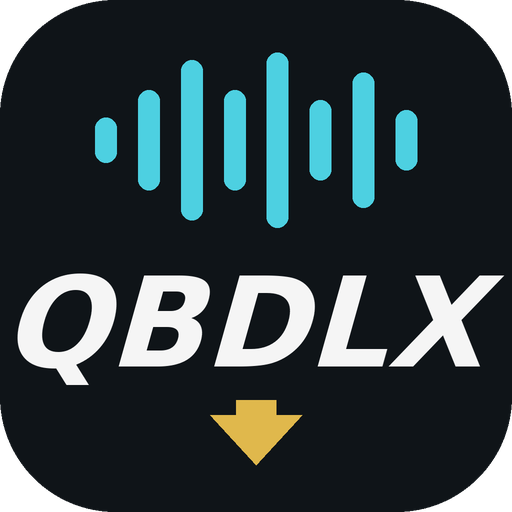

<p align="center">
  
</p>

<h1 align="center">QBDLX</h1>
<p align="center">Android apps to stream and download music from Qobuz, and to find your songs on the phone.</p>

## QBDLX Mobile (`:app`)

- Browse, search, stream and download in Hi-Res (up to 24-bit/192 kHz, FLAC) with a configurable quality.
- Download queue (albums, playlists, single tracks), automatic tagging and cover art.
- Library with favourites, playlists and followed artists; dark / AMOLED themes; notification, widget and Android Auto controls.
- Import a song list (from QBDLX Scanner or a text file): each line is matched on Qobuz and you tick what to download.
- Share downloads to Google Drive; experimental iPod nano export.

On first launch, log in with your Qobuz App ID and App Secret plus either email/password or user ID/auth token.
Downloads are saved to `Music/QobuzDownloaderX/<Artist>/<Album>/`.

## QBDLX Scanner (`:scanner`)

A small companion app: finds the songs on the phone, reads their tags and, for untagged or generically named ones,
identifies them by sound with AcoustID (Chromaprint fingerprint). Call and voice recordings and uncommon folders are skipped.
It exports `qbdlx-songs.json` through the share menu, which QBDLX Mobile imports.
AcoustID needs a free *Application* API key from <https://acoustid.org/new-application> (not your User API key).

## Q Lyrics (`:lyrics`)

Shows the lyrics of the song playing in any music app on the phone and, as a list
that follows the current line, on Android Auto. It reads the playing song through Android's media sessions (needs
"Notification access") and gets synced lyrics from [LRCLIB](https://lrclib.net). Sideloaded apps only appear in Android Auto
with its developer mode and "Unknown sources" turned on. EXPERIMENTAL: not tested in a car.

## Build

Requires JDK 17 and the Android SDK (platform 35).

```
./gradlew assembleDebug testDebugUnitTest :scanner:testDebugUnitTest :lyrics:testDebugUnitTest
```

APKs: `app/build/outputs/apk/debug/` and `scanner/build/outputs/apk/debug/`, `lyrics/build/outputs/apk/debug/`. CI uploads both as workflow artifacts.

## Credits
Inspired by Qo-DL by Sorrow & Dash and by ImAiiR. Third-party code and licences: see [THIRD_PARTY.md](THIRD_PARTY.md).

## License
GNU General Public License v3.0 or later: see [LICENSE](LICENSE). Bundled and ported third-party code keeps its own licence (see [THIRD_PARTY.md](THIRD_PARTY.md)); the Chromaprint port is LGPL-2.1-or-later, which is compatible with GPL-3.0.

## Legal Notice
The author takes no responsibility for how you use these apps.

QBDLX uses the Qobuz API but is neither endorsed, certified, nor approved by Qobuz. The Qobuz name and brand are registered
trademarks of their owner. By using QBDLX you agree to the [Qobuz API Terms of Use](http://static.qobuz.com/apps/api/QobuzAPI-TermsofUse.pdf).

## iPod nano 6G artwork (experimental)
This source includes an isolated RGB565 little-endian encoder for the four artwork dimensions observed in one nano 6G diagnostic. It does not yet write ArtworkDB/ITHMB records; artwork export remains disabled until the binary record layout and offset update sequence are validated against the device.
