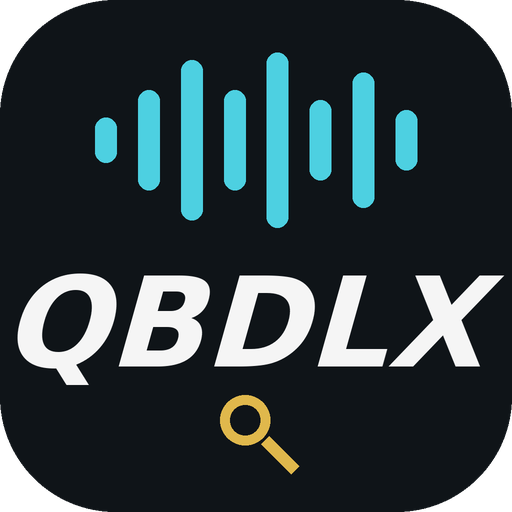
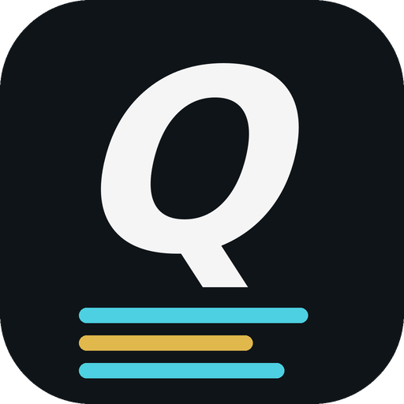

<h1 align="center">QBDLX</h1>

<p align="center">
  Three Android apps: stream and download Hi-Res music from Qobuz, find the songs on your phone, and see synced lyrics, with experimental iPod nano 6G sync.
</p>

<p align="center">
  
  
  
  
</p>

<p align="center">
  <a href="#features">Features</a> ·
  <a href="#the-apps">The apps</a> ·
  <a href="#getting-started">Getting started</a> ·
  <a href="#build-from-source">Build</a> ·
  <a href="#ipod-nano-6g-support">iPod</a> ·
  <a href="#documentation">Docs</a> ·
  <a href="#credits">Credits</a>
</p>

<table align="center">
  <tr>
    <td align="center" width="260">
      <br/>
      <b>QBDLX Mobile</b><br/>
      <sub>Stream, download and manage your Qobuz library</sub>
    </td>
    <td align="center" width="260">
      <br/>
      <b>QBDLX Scanner</b><br/>
      <sub>Find and identify the songs on your phone</sub>
    </td>
    <td align="center" width="260">
      <br/>
      <b>QBDLX Lyrics</b><br/>
      <sub>Synced lyrics for any music app, plus Android Auto</sub>
    </td>
  </tr>
</table>

<!-- Add screenshots here: place images in assets/ and uncomment
<p align="center">
  
  
  
</p>
-->

---

## Features

| | |
|---|---|
| **Hi-Res audio** | Browse, search, stream and download up to 24-bit / 192 kHz FLAC, with configurable quality. |
| **Download queue** | Albums, playlists and single tracks, with automatic tagging and cover art. |
| **Library** | Favourites, playlists and followed artists. |
| **Player** | Dark and AMOLED themes, notification, widget and Android Auto controls. |
| **Song import** | Import a list from QBDLX Scanner or a text file; each line is matched on Qobuz and you tick what to download. |
| **Cloud sharing** | Share downloads to Google Drive. |
| **iPod export** | Experimental export to an iPod (tested only on the nano 6G). |

## The apps

This repository is a multi-module Gradle project.

| Module | Description |
|---|---|
| `:app` | **QBDLX Mobile**: the main player and downloader. |
| `:scanner` | **QBDLX Scanner**: finds the songs on your phone and reads their tags. Untagged or generically named files are identified by sound with AcoustID (Chromaprint fingerprint). Call and voice recordings and uncommon folders are skipped. It exports `qbdlx-songs.json` through the share menu, which QBDLX Mobile imports. |
| `:lyrics` | **QBDLX Lyrics**: shows the lyrics of the song playing in any music app on the phone and, as a list that follows the current line, on Android Auto. It reads the playing song through Android media sessions (needs "Notification access") and gets synced lyrics from [LRCLIB](https://lrclib.net). Sideloaded apps only appear in Android Auto with its developer mode and "Unknown sources" turned on. Experimental: not tested in a car. |

> AcoustID needs a free *Application* API key from [acoustid.org](https://acoustid.org/).

## Getting started

1. Install the APK on a device running Android 10 or newer.
2. On first launch, log in with your Qobuz **App ID** and **App Secret**, plus either email and password or user ID and auth token.
3. Search, stream or queue downloads.

Downloads are saved to:

```
Music/QobuzDownloaderX/<Artist>/<Album>/
```

## Build from source

Requirements: JDK 17 and the Android SDK (platform 35).

```bash
git clone https://github.com/TheRR-ctrl/Qbz-downloader-mobile.git
cd Qbz-downloader-mobile
./gradlew assembleDebug testDebugUnitTest :scanner:testDebugUnitTest :lyrics:testDebugUnitTest
```

APKs are generated in `app/build/outputs/apk/debug/`, `scanner/build/outputs/apk/debug/` and `lyrics/build/outputs/apk/debug/`.

## iPod nano 6G support

QBDLX Mobile includes a dock to copy music to an iPod, including artwork and lyrics. **This has only been tested with the iPod nano 6th generation.** Other models are not supported and may not work. The feature is experimental, so back up your iPod first.

## Documentation

- [App overview](docs/README-app.md)
- [Lyrics on iPod](docs/LETRAS_IPOD.md)
- [ArtworkDB format, nano 6G](docs/ARTWORKDB_NANO6G.md)
- [Artwork changelog](docs/CHANGELOG_ARTWORK.md)
- [Artwork limitations](docs/LIMITACIONES_CARATULAS.md)
- [Artwork testing](docs/PRUEBA_CARATULAS.md)
- [Third-party notices](THIRD_PARTY.md)

## Disclaimer

QBDLX uses the Qobuz API but is neither endorsed, certified, nor approved by Qobuz. By using it you agree to the [Qobuz API Terms of Use](http://static.qobuz.com/apps/api/QobuzAPI-TermsofUse.pdf). A valid Qobuz account and subscription are required. Use it for personal purposes only and respect the Qobuz Terms of Service and the rights of artists and labels. You are responsible for how you use this software.

## Credits

- Inspired by [ImAiiR/QobuzDownloaderX](https://github.com/ImAiiR/QobuzDownloaderX).
- Third-party libraries and licenses are listed in [THIRD_PARTY.md](THIRD_PARTY.md).

## License

Released under the [GNU General Public License v3.0 or later](LICENSE). Bundled and ported third-party code keeps its own licence; see [THIRD_PARTY.md](THIRD_PARTY.md).
